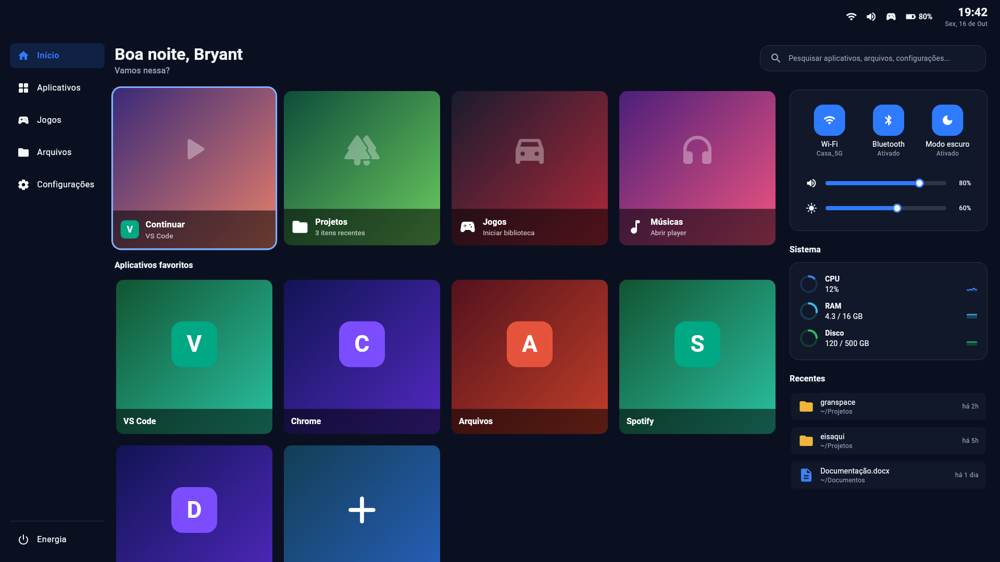
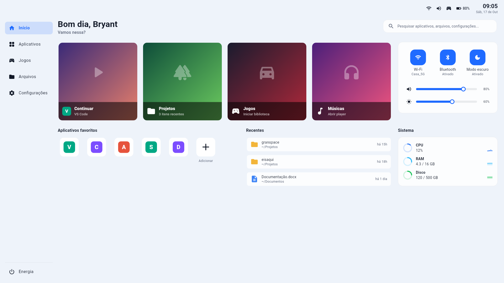

# Gamer Launcher (nome provisório)

[](https://github.com/Bryant-Anjos/gamer-launcher/actions/workflows/ci.yml)
[](LICENSE)

Um launcher em tela cheia, com cara de console, para usar o Linux **com um controle de videogame**: abrir
aplicativos, achar arquivos, ligar o Bluetooth, mudar o volume e desligar o computador sem encostar no teclado.
Feito com Flutter e Rust, pensado para o **Pop!_OS 24.04 com o desktop COSMIC**.

<p align="center">
  
</p>

> As imagens deste README são geradas pelos testes visuais do projeto, com dados de exemplo.

## O que ele faz

- **Tela inicial estilo TV:** cartões de destaque (Continuar, Projetos, Jogos e Músicas), favoritos grandes
  e reordenáveis, com a cor do ícone de cada app, e recentes.
- **Aplicativos e arquivos:** lista tudo o que está instalado (arquivos `.desktop`, com ícones), abre arquivos recentes
  e tem filtro por nome.
- **Pesquisa global:** aplicativos, arquivos recentes e páginas de configurações, aceitando siglas
  (`vsc` acha o Visual Studio Code) e ignorando acentos.
- **Controle rápido (Start):** Wi-Fi, Bluetooth com a lista de dispositivos pareados (conectar e desconectar),
  modo escuro do sistema, volume e brilho, mais atalhos para as configurações de Bluetooth e de rede.
- **Sistema:** gráficos de CPU, memória e disco; bateria e relógio na barra superior.
- **Energia:** suspender, reiniciar, desligar, encerrar a sessão e fechar o launcher.
- **Jogos:** atalho para abrir Steam, Heroic ou Lutris, se estiverem instalados.
- **Personalização:** tema claro, escuro ou **automático pela hora**, papel de parede, painéis que podem ser
  ocultados, sons e animações opcionais, iniciar junto com o sistema.
- **Controles:** reconhece controles Xbox e **Nintendo** (o layout dos botões é automático ou escolhido por você).
- **Claude Code (opcional):** em computadores com o [Claude Code](https://claude.com/claude-code), acompanha sessões,
  agentes e uso. Só aparece se ele estiver instalado; sem ele, nada é lido.

<p align="center">
  
</p>

## Controles

| Ação | Controle | Teclado |
|---|---|---|
| Mover o foco | D-pad ou analógico esquerdo (segurar repete) | Setas |
| Confirmar | A | Enter |
| Voltar | B | Esc |
| Pesquisar | Y | — |
| Controle rápido | Start (o `+` no controle Nintendo) | — (a tela inicial também mostra o painel embutido) |
| Trocar de seção | LB e RB | Setas na navegação lateral |
| Voltar ao Início | Home (o botão central) | — |
| Fechar o launcher | Menu **Energia > Fechar o launcher** | Ctrl+Q |

Num controle Nintendo (Pro Controller, por exemplo), o launcher usa os rótulos impressos nos botões: o **A** fica
à direita e confirma, o **B** fica embaixo e volta. Em **Configurações > Botões do controle** dá para forçar o layout
Xbox ou Nintendo. A pesquisa é digitada no teclado físico; não há teclado na tela.

## Requisitos

- Linux x86_64 com **GTK 3** e **udev**. Testado no **Pop!_OS 24.04 (COSMIC, Wayland)**.
- Para as funções do controle rápido, as ferramentas do sistema usadas por trás: `nmcli` (NetworkManager),
  `bluetoothctl` (BlueZ), `wpctl` (PipeWire) e `busctl` (logind, para o brilho). O que faltar aparece como
  "Indisponível" na tela, sem travar nada.

## Instalar

Ainda não há versões publicadas na aba *Releases*. Por enquanto, gere o pacote `.deb` no seu computador
(precisa do [Flutter](https://flutter.dev) 3.47.7 e do [Rust](https://rustup.rs) estável):

```bash
# dependências de sistema (Ubuntu/Pop!_OS 24.04)
sudo apt install clang cmake ninja-build pkg-config libgtk-3-dev libudev-dev libstdc++-14-dev

# compila o app
cd app
flutter pub get
mkdir -p build/native_assets/linux
flutter build linux --release
cd ..

# gera e instala o pacote
packaging/linux/build-deb.sh app/build/linux/x64/release/bundle dist
sudo apt install ./dist/gamer-launcher_0.1.0_amd64.deb
```

Depois é só abrir **Gamer Launcher** no menu de aplicativos, ou rodar `gamer-launcher` no terminal.
Para rodar sem instalar: `app/build/linux/x64/release/bundle/gamer_launcher`.

### Atualizar e desinstalar

```bash
sudo apt remove gamer-launcher          # desinstala (suas configurações continuam em ~/.config)
sudo apt install --reinstall ./dist/gamer-launcher_0.1.0_amd64.deb   # reinstala a mesma versão
```

## Onde ficam os seus dados

| Arquivo | O que guarda |
|---|---|
| `~/.config/gamer-launcher/settings.json` | Tema, papel de parede, painéis, favoritos e layout dos botões |
| `~/.local/state/gamer-launcher/history.json` | O último aplicativo aberto (cartão Continuar) |
| `~/.config/autostart/gamer-launcher.desktop` | Existe só se você ligar **Iniciar com o sistema** |

**Privacidade:** o launcher não faz nenhuma conexão de rede por conta própria (não há código de rede no projeto).
Ele só lê arquivos locais (aplicativos instalados, arquivos recentes e, se existir, a pasta do Claude Code, somente
leitura) e roda programas do sistema para ligar e desligar coisas.

## Como o projeto é organizado

| Pasta | Conteúdo |
|---|---|
| `core/` | Núcleo em Rust, sem interface: apps, busca, configurações, controle do sistema, leitura de controles |
| `app/` | Aplicativo Flutter (telas, tema, navegação por foco) |
| `app/rust/` | Ponte fina (`flutter_rust_bridge`) entre o Flutter e o núcleo |
| `packaging/linux/` | Geração do `.deb` e do AppImage |
| `docs/roteiro/` | Roteiro de testes manuais (fonte do site de testes) |
| `tools/` | Controle virtual para testar sem hardware e o verificador do roteiro |
| `PLAN.md` | Decisões, fases, medições e pendências |

## Desenvolvimento

```bash
make check          # núcleo, ponte, app, empacotamento e roteiro: tudo precisa estar verde
make core-check     # só o núcleo Rust (fmt, clippy e testes)
make app-check      # só a ponte e o app Flutter (análise e testes)
```

- O projeto é desenvolvido com **TDD** (teste primeiro) e tem centenas de testes, incluindo testes visuais
  (*golden*) das telas.
- Para testar o controle sem um controle de verdade, `tools/virtual_pad.py` cria um controle virtual
  (`/dev/uinput`) que imita um Xbox 360.
- Mudou algo que o usuário vê ou faz? O **roteiro de testes manuais** (`docs/roteiro/`) precisa mudar junto, e
  `make roteiro-check` falha se ficar para trás. As regras de trabalho estão no [`CLAUDE.md`](CLAUDE.md).

## Estado do projeto e limitações

É uma versão inicial (0.1.0), feita principalmente para o Pop!_OS 24.04 com COSMIC e usada até aqui com um
Pro Controller da Nintendo por Bluetooth.

- Em outros desktops (GNOME, KDE) o launcher abre, mas o **modo escuro do sistema**, as **páginas de configurações**
  da pesquisa (chamam o `cosmic-settings`) e o **volume** (usa o PipeWire) dependem do COSMIC e podem ficar
  indisponíveis.
- Ainda não existem: lista de redes Wi-Fi para conectar, pareamento de dispositivos Bluetooth **novos** (só os já
  pareados) e teclado na tela.
- Windows e macOS estão nos planos, mas ainda não existem.
- O AppImage é montado pela CI de *release* e ainda não foi verificado de ponta a ponta.

## Licença

[MIT](LICENSE).
